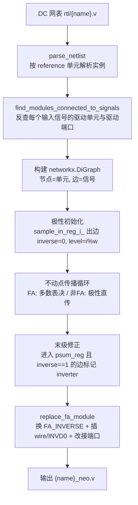

# 极性翻转 FA（FA_INVERSE）重构加法树 —— 原理与实现说明

> **工程定位**：对 Synopsys Design Compiler 综合出的门级网表（`rtl/*.v`，标准单元库 `*BWP30P140HVT`）做后端逻辑重构——把加法树中的标准全加器替换为**极性翻转全加器 FA_INVERSE**，并在极性不一致的边界处插入**数量最少**的 `INVD0` 反相器，输出等价网表 `*_neo.v`，从而省掉每个 FA 输出级的 2 个反相器，降低功耗与时序压力。

---

## 1. 一句话概括替换逻辑

> **三个输入同时取反的全加器，其 `S`、`CO` 输出恰好等于正确值的反。** 因此只要把树里所有 FA 换成"输出天生反相"的 `FA_INVERSE` 单元，反相就能沿着树**成对抵消**地传播；只需在极性"混合"的少数派输入边和电路边界补上少量显式反相器，功能完全等价，而每个 FA 内部的 2 个输出反相器被永久省掉。

---

## 2. 数学原理：为什么反相能"穿过"全加器

全加器的逻辑功能为：

\[
S = A \oplus B \oplus CI,\qquad CO = A\cdot B + CI\cdot(A\oplus B) = \mathrm{MAJ}(A, B, CI)
\]

它依赖两条代数性质：

1. **XOR 的奇函数性**：对奇数个输入取反，XOR 结果取反。
   \[
   \lnot A \oplus \lnot B \oplus \lnot CI = \lnot\,(A \oplus B \oplus CI) = \lnot S
   \]
2. **MAJ 的自对偶性**：多数函数取反输入等价于取反输出。
   \[
   \mathrm{MAJ}(\lnot A, \lnot B, \lnot CI) = \lnot\,\mathrm{MAJ}(A, B, CI) = \lnot\, CO
   \]

真值表验证（输入全取反 ⇔ 输出全取反）：

| A B CI | S | CO | ¬A ¬B ¬CI 时的 S′ | ¬A ¬B ¬CI 时的 CO′ |
|:------:|:-:|:--:|:-----------------:|:------------------:|
| 0 0 0  | 0 | 0  | 1 (=¬S)           | 1 (=¬CO)           |
| 0 0 1  | 1 | 0  | 0 (=¬S)           | 1 (=¬CO)           |
| 0 1 0  | 1 | 0  | 0 (=¬S)           | 1 (=¬CO)           |
| 0 1 1  | 0 | 1  | 1 (=¬S)           | 0 (=¬CO)           |
| 1 0 0  | 1 | 0  | 0 (=¬S)           | 1 (=¬CO)           |
| 1 0 1  | 0 | 1  | 1 (=¬S)           | 0 (=¬CO)           |
| 1 1 0  | 0 | 1  | 1 (=¬S)           | 0 (=¬CO)           |
| 1 1 1  | 1 | 1  | 0 (=¬S)           | 0 (=¬CO)           |

### 2.1 极性翻转单元 FA_INVERSE

标准库全加器（`FA1D0BWP30P140HVT` / `FA1D1BWP30P140HVT`）的内部结构天然产生反相的中间结果，要输出**正相**的 `S`、`CO` 必须在输出级各挂 1 个反相器，即：

```
标准 FA  ≈ FA核 + INV(S) + INV(CO)      实测功耗 246.27 µW
FA_INVERSE ≈ FA核（直接输出 ¬S、¬CO）    实测功耗 145.33 µW
```

### 2.2 反相的传播与抵消

把整棵树的 FA 全部换成 `FA_INVERSE` 后，按"线上极性"（该信号相对原网表是否取反）逐级推导：

- **FA_INVERSE → FA_INVERSE 直连**：上游输出反相、下游把反相值当输入再"反相一次"，双重取反自动抵消，**中间不需要任何反相器**；
- **极性混合的 FA**：三个输入中极性不一致时，在**少数派**那条边上插 1 个 `INVD0` 把极性统一（3 选 1，而不是插 2 个）；
- **电路边界**（主输入寄存器 / 末级 `psum_reg`）：极性为反的地方补 1 个 `INVD0` 保证顶层端口功能不变。

以 `e2_w4` 为例：10 个 FA 共省掉 `2×10 = 20` 个等效输出反相器，只需回补 8 个边界/混合点 `INVD0`。

---

## 3. 核心算法：极性传播与替换决策（[main.py](file:///d:/Document/2025B/FA_inverse_out_v1/FA_inverse_out_v1/main.py)）

### 3.1 流程总览



### 3.2 网表解析与驱动源反查

- [parse_and_process_netlist.py](file:///d:/Document/2025B/FA_inverse_out_v1/FA_inverse_out_v1/parse_and_process_netlist.py) 按单元类型（`reference` 列表）逐实例解析，支持跨行端口列表，返回 `{实例名: {module_name, ports{端口: 信号}}}` 与原始行列表 `list_new`；
- [find_connected.py](file:///d:/Document/2025B/FA_inverse_out_v1/FA_inverse_out_v1/find_connected.py) 对当前单元的每个输入信号全网表反查：由哪个单元的哪个**输出端口**（`CO / S / Q / ZN / Z`）驱动；查不到驱动源则记为 `input_port`（模块主输入）。

涉及的单元及端口方向：

| 单元 | 功能 | 输入 | 输出 |
|---|---|---|---|
| `DFCNQD1BWP30P140HVT` | DFF | D, CP, CDN | Q |
| `FA1D0/FA1D1BWP30P140HVT` | 全加器 | A, B, CI | CO, S |
| `AN2D0BWP30P140HVT` | AND2 | A1, A2 | Z |
| `INVD0BWP30P140HVT` | INV | I | ZN |
| `ND3D0P7 / NR2D0` | NAND3 / NOR2 | A1(,A2)(,A3) | ZN |
| `AOI21D0(P7) / IAO21D0/D1` | AOI21 / OAI21 | A1, A2, B | ZN |
| `OA21D0BWP30P140HVT` | OAI21-型 | A1, A2, B | Z |
| `CKND2D1BWP30P140HVT` | NAND2 | A1, A2 | ZN |

### 3.3 图模型与关键属性

以单元为节点、信号为有向边（驱动单元 → 负载单元）建图，**极性决策的全部状态都挂在边上**：

| 边属性 | 含义 |
|---|---|
| `edge_name` | 信号（wire）名 |
| `output` | 驱动端口（`CO / S / Q / ZN / Z`），决定位权传播 |
| `inverse` | **线上极性**：`-1` 未知 / `0` 与原网表同相 / `1` 相对原网表取反 |
| `inverter` | 是否需要插入显式 `INVD0`（`1` = 插） |
| `level` | 位权：**S 边不变、CO 边 +1**（进位权重升一位） |

设计规模由模块名解析：`e{n}_w{w}_...` → 输入数 `2^n × w`（如 `e2_w4` 为 16 个 `sample_in_reg_i_`），输出位宽 `psum_num = n + w`。

### 3.4 极性初始化

从每个输入寄存器 `sample_in_reg_i_` 出发的边初始化为 `inverse = 0`（寄存器 Q 端输出原值），`level = i % w`（输入按位权交错排列，第 `i` 个采样属于第 `i % w` 位）。

### 3.5 不动点传播 + FA 多数表决（替换决策的核心）

```python
while 仍存在 inverse == -1 的边:          # 不动点迭代
    for 每个输入寄存器做 BFS:
        for BFS 序中的每条边 (u → v):
            收集 v 的全部入边极性 inverse_group
            if -1 in inverse_group: 跳过   # 上游极性未知, 留到下一轮
            if v 是 FA:
                按下方表决规则决定 output_polar 与 inverter 位置
            else:
                output_polar = inverse_group[0]   # 非FA单元: 极性直传
            将 output_polar 写入 v 的所有出边（CO 边 level+1, S 边 level 不变）
```

**FA 节点的表决规则**（`inverse_ref` 中的 FA 单元）：

| 三输入极性组合 | 决策 | 等效输入极性 | `FA_INVERSE` 输出极性 |
|---|---|---|---|
| `0, 0, 0`（全同相） | 不插 INV | 全 0 | `1`（输出取反） |
| `1, 1, 1`（全反相） | 不插 INV | 全 1 | `0`（双重取反，输出回正） |
| `0, 0, 1`（少数派为 1） | 在极性 1 的边上插 1 个 INV，该边置 0 | 全 0 | `1` |
| `0, 1, 1`（少数派为 0） | 在极性 0 的边上插 1 个 INV，该边置 1 | 全 1 | `0` |

要点：

- **少数服从多数**：混合极性时只花 1 个 `INVD0` 把少数派边"掰正"，而不是把多数派的两条边各插一个；
- 被插 INV 的边 `inverter = 1`，其 `inverse` 改写为统一后的值；FA 输出边统一获得 `output_polar`；
- **非 FA 单元按极性直传**（输出极性 = 输入极性）——这是一个简化假设，其成立条件见 §8。

### 3.6 末级输出修正

传播收敛后，遍历所有进入 `psum_reg_i_` D 端的边：若 `inverse == 1`（末级 FA 输出是反值），标记 `inverter = 1`，在**寄存器一侧**改接反相器输出，保证模块顶层输出 `psum` 极性正确（见 §4 规则 3）。

---

## 4. 网表改写规则（[w_and_rm_netlist.py](file:///d:/Document/2025B/FA_inverse_out_v1/FA_inverse_out_v1/w_and_rm_netlist.py)）

`replace_fa_module(list_new, wire声明, replace_info, inv实例列表)` 按以下 4 条规则改写原始行列表：

1. **单元替换（全树统一）**：所有 `FA1D0BWP30P140HVT` / `FA1D1BWP30P140HVT` → `FA_INVERSE`；
2. **中间边插反相器**：对 `inverter = 1` 的边 `u → v`——
   - 新增 wire，命名为 `驱动单元名_负载单元名`（如 `U8_U7`）；
   - 追加实例 `INVD0BWP30P140HVT inv_i_ ( .I(原信号), .ZN(新wire) );`
   - **负载单元 v 的对应输入端口改接新 wire，驱动单元 u 原样不动**；
3. **末级例外**：信号直接进 `psum_reg` 时反过来——**寄存器 D 端改接**新 wire（如 `intadd_0_U6_psum_reg_0_`），FA 输出保持原 wire，从而不触碰模块输出端口；
4. **主输入例外**：`sample_in[i]` 直接进 FA 且需要反相时，反相器挂在 FF 之后（`sample_in_reg_3__U9`），FF 本身不动。

插入位置：新 wire 声明紧跟第一条 `wire` 行之后；`INVD0` 实例统一追加在 `endmodule` 之前。

---

## 5. 实例走查：`e2_w4_fixed_adder_tree`

**原树结构**（[原网表](file:///d:/Document/2025B/FA_inverse_out_v1/FA_inverse_out_v1/rtl/e2_w4_fixed_adder_tree_1.5ns_all_auto.v)）：5 个"约简" FA（`U7`~`U11`，直接吃采样寄存器输出）+ 1 个与/或非小锥（`U3`~`U6`，AN2/IAO21 产生 `intadd_0_CI` 等）+ 5 个行内 Ripple FA（`intadd_0_U6`→`U5`→`U4`→`U3`→`U2`），后者逐位产出 `psum[0..5]`。

极性传播决策表（对照 [重构后网表](file:///d:/Document/2025B/FA_inverse_out_v1/FA_inverse_out_v1/rtl/e2_w4_fixed_adder_tree_1.5ns_all_auto_neo.v)）：

| FA 实例 | 输入（端口: 信号） | 原始极性 | 决策 | 输出极性 → 末级处理 |
|---|---|:---:|---|---|
| `U10` | A/B/CI: `sample_in[10/6/14]` | 0,0,0 | 全 0，免 INV | 1 →（内部消耗） |
| `U11` | A/B/CI: `sample_in[11/7/15]` | 0,0,0 | 全 0，免 INV | 1 →（内部消耗） |
| `U8` | `sample_in[9]`, `sample_in[1]`, `n3`(AN2) | 0,0,0 | 全 0，免 INV | 1 →（内部消耗） |
| `U9` | `sample_in[3]`, `n5`(U11.S), `n4`(U10.CO) | **0**,1,1 | 少数派 A → `inv_0_` | 0 |
| `U7` | `sample_in[2]`, `n2`(U8.CO), `n1`(AN2) | 0,**1**,0 | 少数派 B → `inv_6_` | 1 |
| `intadd_0_U6` | `sample_in[8]`, `sample_in[4]`, `intadd_0_CI` | 0,0,0 | 全 0，免 INV | 1 → `psum[0]` 需 `inv_1_` |
| `intadd_0_U5` | `intadd_0_B_1_`, `intadd_0_A_1_`(U8.S), `intadd_0_n5` | **0**,1,1 | 少数派 A → `inv_4_` | 0 → `psum[1]` 免 INV |
| `intadd_0_U4` | `intadd_0_B_2_`(U10.S), `intadd_0_A_2_`(U7.S), `intadd_0_n4` | 1,1,**0** | 少数派 CI → `inv_2_` | 0 → `psum[2]` 免 INV |
| `intadd_0_U3` | `intadd_0_B_3_`(U7.CO), `intadd_0_A_3_`(U9.S), `intadd_0_n3` | **1**,0,0 | 少数派 A → `inv_5_` | 1 → `psum[3]` 需 `inv_3_` |
| `intadd_0_U2` | `intadd_0_B_4_`(U9.CO), `intadd_0_A_4_`(U11.CO), `intadd_0_n2` | **0**,1,1 | 少数派 A → `inv_7_` | 0 → `psum[4]`/`psum[5]` 免 INV |

改写前后对照（`intadd_0_U5` 一例，加粗为改动点）：

```verilog
// 原网表
FA1D0BWP30P140HVT intadd_0_U5 ( .A(intadd_0_B_1_), .B(intadd_0_A_1_), .CI(
      intadd_0_n5), .CO(intadd_0_n4), .S(edge_nd_33) );

// _neo.v：单元换 FA_INVERSE，A 端改接反相器输出
FA_INVERSE intadd_0_U5 ( .A(**U6_intadd_0_U5**), .B(intadd_0_A_1_), .CI(intadd_0_n5), .CO(intadd_0_n4), .S(edge_nd_33) );
INVD0BWP30P140HVT **inv_4_** (.I(intadd_0_B_1_),.ZN(**U6_intadd_0_U5**));

// 末级例外：psum_reg_0_ 的 D 端改接，FA 输出 edge_nd_32 原样保留
DFCNQD1BWP30P140HVT psum_reg_0_ ( .D(**intadd_0_U6_psum_reg_0_**), ... );
INVD0BWP30P140HVT **inv_1_** (.I(edge_nd_32),.ZN(**intadd_0_U6_psum_reg_0_**));
```

统计：10 个 FA 全部替换，共插 8 个 `INVD0`（6 个混合极性少数派 + 2 个反相末级输出），净省 12 个等效反相器；其余 FA→FA 直连处（如 `intadd_0_U4.B ← intadd_0_U5.S`、`intadd_0_U2.CI ← intadd_0_U3.CO`）零反相器。

---

## 6. 扩展流程：部分反相变体（main.py 中注释掉的分支）

当一个 FA 的 `S`、`CO` 下游**极性需求不同**（或扇出 > 1）时，可选用更细粒度的定制单元，进一步少拆内部反相器：

| 变体 | 语义 | 等效内部结构 | 实测功耗 |
|---|---|---|---|
| `FA_INVERSE` | S、CO 都反相 | FA 核 | 145.33 µW |
| `FA_INVERSE_S` | 仅 S 反相，CO 保持原相 | FA 核 + INV(CO) | 176.66 µW |
| `FA_INVERSE_CO` | 仅 CO 反相，S 保持原相 | FA 核 + INV(S) | 214 µW |
| 标准 `FA1D0/FA1D1` | 都保持原相 | FA 核 + INV×2 | 246.27 µW |

该流程的决策链（[duplicate_process.py](file:///d:/Document/2025B/FA_inverse_out_v1/FA_inverse_out_v1/duplicate_process.py) + `replace_module_declarations`）：

1. `find_duplicate_names`：统计每个 FA 作为驱动源出现的次数（1/2/3 次 → 扇出规模）；
2. `merge_module_ports`：把同一 FA 各消费端记录的端口需求（`S` / `CO`）合并去重，如 `[CO,CO,CO]` 消费后又出现 `CO` 消费 → 合并为仅需 `S` 反相；
3. `replace_module_declarations` 按合并结果选型：
   - 仅 `S` 需求 → `FA_INVERSE_S`；仅 `CO` 需求 → `FA_INVERSE_CO`；
   - `S`、`CO` 都需要（`['S','CO']` 或三项以上记录）→ `FA_INVERSE`；
4. 输出统计日志到 `*_tot_rpt.v`（可替换 FA 数、移除反相器数、功耗估算）。

---

## 7. 功耗估算模型

日志中使用的两组实测/估算数据：

- **Cadence Transition 仿真**（相对单 FA 功耗的节省比例）：全反相替换 `31%`、仅 S 反相 `18%`、仅 CO 反相 `14.6%`；
- **Design Compiler**：按上表单元功耗加权，`优化后功耗 = 剩余 FA×246.27 + FA_INVERSE_CO×214 + FA_INVERSE×145.33 + FA_INVERSE_S×176.66`（µW）；
- 移除的等效反相器数 `inv_num_rm = 2×N(FA_INVERSE) + N(FA_INVERSE_S) + N(FA_INVERSE_CO)`，上限为 `2×FA总数`。

---

## 8. 假设、限制与注意事项

1. **非 FA 单元极性直传是简化假设**：`output_polar = inverse_group[0]` 隐含要求这些门（AN2/IAO21/AOI21 等）要么输入极性全 0（当前算例中非 FA 锥的输入均直接来自寄存器，成立），要么后续用对应双极性变体单元吸收反相；
2. **改写使用字符串替换**（`line.replace(原信号, 新信号)`）：若信号名互为前缀（如 `n1` 与 `n10`）存在误替换风险，扩充设计时建议加词边界匹配；
3. **可达性假设**：极性传播以输入寄存器为起点做 BFS，要求所有单元均从 `sample_in_reg_*` 可达，否则 `inverse = -1` 的边会使不动点循环无法收敛；
4. **路径硬编码**：`main.py` 中 `abs_path = '/home/evcong/.../rtl'` 为 Linux 路径，跨平台运行需修改；选择设计只改 `module_name` 变量；
5. `find_connected` 为 O(单元数 × 信号数) 的纯 Python 全扫描，大网表较慢；
6. [main.py.bak](file:///d:/Document/2025B/FA_inverse_out_v1/FA_inverse_out_v1/main.py.bak) 为历史版本（`find_connected` 内联、含 `contains_only_co_s` 等早期函数）；[revise_netlist.py](file:///d:/Document/2025B/FA_inverse_out_v1/FA_inverse_out_v1/revise_netlist.py)、[buid_graph.py](file:///d:/Document/2025B/FA_inverse_out_v1/FA_inverse_out_v1/buid_graph.py)、[test.py](file:///d:/Document/2025B/FA_inverse_out_v1/FA_inverse_out_v1/test.py) 为占位/实验脚本；[readme.txt](file:///d:/Document/2025B/FA_inverse_out_v1/FA_inverse_out_v1/readme.txt) 是早期对 `parse_netlist` 的自动解释，与本主题无关。

---

## 附录 A：文件清单

| 文件 | 职责 |
|---|---|
| `main.py` | 主流程：解析 → 建图 → 极性传播表决 → 生成 `_neo.v` |
| `parse_and_process_netlist.py` | DC 网表解析（实例/端口/信号） |
| `find_connected.py` | 输入信号 → 驱动单元/驱动端口反查 |
| `w_and_rm_netlist.py` | 网表改写：插 wire、插 INVD0、替换 FA 单元名 |
| `duplicate_process.py` | （变体流程）扇出统计与端口需求合并 |
| `gen_verilog_netlist.py` | 从结构化 dict 反生成 Verilog（调试用） |
| `rtl/*.v` | 各组实验网表：`e{实验组}_w{位宽}`，含原始版与 `_neo` 重构版；**本仓库仅收录 4 组代表性算例**：`e2_w4`（文档 §5 走查用例）、`e3_w8`、`e5_w8_2ns`、`e5_w8_ripple`（波纹进位结构对照），其余算例与 `rtl_bak/` 备份保留在本地、不入库 |

## 附录 B：产物文件对照

| 后缀 | 内容 |
|---|---|
| `{name}.v` | 原始 DC 网表 |
| `{name}_fa_rpt.v` | 图连接关系报告：每单元 `[实例名, 节点号]` 及其各输入的 `[驱动单元, 驱动端口, 信号]` |
| `{name}_fa_rpt_ref.v` / `_dup.v` | 变体流程的重复 FA 报告 |
| `{name}_tot_rpt.v` | 可替换统计与功耗估算日志 |
| `{name}_neo.v` | **极性翻转重构后的最终网表** |
